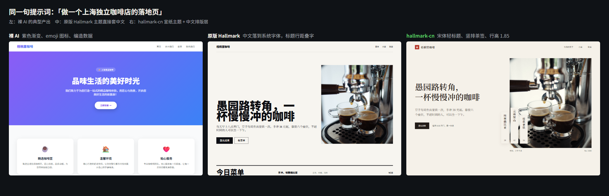
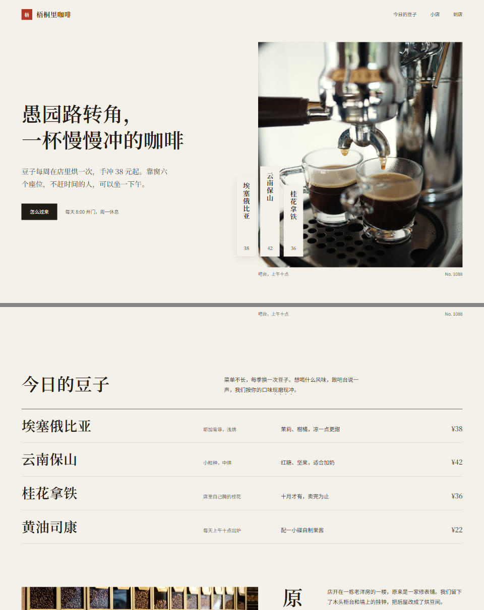
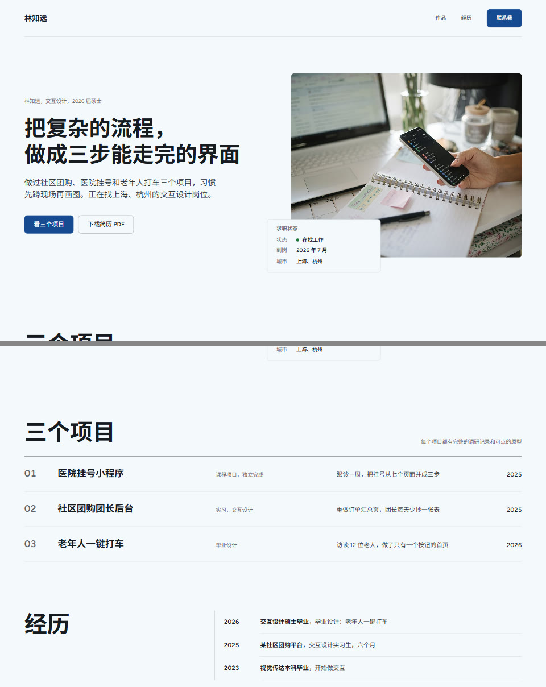

# Hallmark 中文版（hallmark-cn）

> 基于 [Nutlope/hallmark](https://github.com/Nutlope/hallmark)（Together AI 出品，MIT 协议）的中文排版增强版。感谢原作者 [@Nutlope](https://github.com/Nutlope) 和 Hallmark 团队，原版说明见 [README.en.md](README.en.md)，原 [LICENSE](LICENSE) 保留不变。

**让 Claude Code / Cursor / Codex 生成的中文网页，看起来像设计师做的，而不是 AI 吐出来的。**



同一句提示词「做一个上海独立咖啡店的落地页」：

| 裸 AI | 原版 Hallmark | hallmark-cn |
| --- | --- | --- |
| 紫色渐变、emoji 图标、「10000+ 满意顾客」这种编出来的数据 | 有设计感，但 50 个主题全是英文字体：中文落到系统字体，标题行高 0.92 直接上下叠字 | 宋体轻标题、竖排茶签、行高 1.85 正文、全角标点、自托管中文字体子集 |

## 这个版本加了什么

原版 Hallmark 是目前最好的「反 AI 味」设计 Skill 之一，但它的全部规则和主题都是为拉丁字母写的，`references/` 里没有一条中文排版规则。中文版补上这一层，原版的所有规则、主题、检查脚本照常工作。

1. **中文排版层** [`skills/hallmark/references/cjk.md`](skills/hallmark/references/cjk.md)：中文页面自动加载。
   - 字体栈：拉丁字母按主题走，汉字按主题的字体类配思源宋体 / 思源黑体 / 站酷庆科黄油体 / 霞鹜文楷，末尾带苹方、微软雅黑等系统回退。
   - 字号行高：正文 16 到 18px、行高 1.7 到 1.8；标题行高不低于 1.15，不用负字距，不用斜体（中文没有真斜体）。
   - 标点与混排：`line-break: strict` 避头尾，`text-autospace` 中英文间距，`text-spacing-trim` 标点挤压，标题 `keep-all` 只在标点处换行。
   - 国内可访问字体源：`fonts.googleapis.com` 在大陆时通时不通，改用镜像或自托管。
   - 中文文案 slop 黑名单：赋能、打造、一站式、「不止是 X，更是 Y」……
2. **3 个中文主题**（照原版格式，每个一份 ≤8 KB 的主题文件加一张配图，均通过原版 `theme.mjs validate` 的对比度和规则检查）：

<table>
  <tr>
    <td width="33%"><a href="lab/demo/cn/index.html"></a></td>
    <td width="33%"><a href="lab/demo/yeshi/index.html"></a></td>
    <td width="33%"><a href="lab/demo/shangwu/index.html"></a></td>
  </tr>
  <tr>
    <td><b>宣纸</b> <code>xuanzhi</code><br/><sub>咖啡、茶、书店、展览、民宿、文化品牌。宋体轻标题、竖排茶签、朱砂印章</sub></td>
    <td><b>夜市</b> <code>yeshi</code><br/><sub>餐饮、小吃、奶茶、酒吧、潮牌、快闪。招牌字、灯箱菜单、钠灯黄价格</sub></td>
    <td><b>商务</b> <code>shangwu</code><br/><sub>官网、SaaS、律所财务、求职作品集。思源黑体、台账式列表、藏青只给按钮</sub></td>
  </tr>
</table>

3. **中文提示词直接发牌**：`theme.mjs deal` 支持中文关键词，「夜市烧烤摊」会发到夜市主题，「应届生求职作品集」会发到商务主题。
4. **Windows 修复**：原版在 Windows 上 `git clone` 后，CRLF 换行会让安装校验报错、拒绝安装。中文版修了 `refcheck.mjs` 的换行识别，并加了 `.gitattributes` 统一 LF。

## 一键安装

需要 [Node.js 18+](https://nodejs.org/zh-cn)。

**Windows：** 下载或 `git clone` 本仓库，双击 [`lab/install.bat`](lab/install.bat)。它会先校验全部主题和参考文件，再装进本机找到的 Claude Code / Codex / Cursor / OpenCode。

**命令行（任意系统）：**

```bash
git clone https://github.com/cryanxc/hallmark-cn.git
cd hallmark-cn
node skills/hallmark/scripts/install.mjs
```

只装 Claude Code 加 `--claude`；先看会装到哪里加 `--dry-run`。

## 用法

在 Claude Code 里：

```
/hallmark 做一个上海独立咖啡店的落地页
/hallmark 做一个应届生求职作品集，主题用商务
/hallmark 做一个夜市烧烤摊的菜单页
```

指定主题直接说主题名（宣纸、夜市、商务，或原版 50 个英文主题的名字）；原版主题遇到中文内容也会按 `cjk.md` 补中文字体和行距。

## 看演示

双击 [`lab/preview.bat`](lab/preview.bat)（或运行 `node lab/serve.mjs`），浏览器打开 `http://localhost:4174/compare.html`：左中右三栏就是上面那张对比图的实时版本；三个中文主题的完整页面在 `/cn/`、`/yeshi/`、`/shangwu/`，源文件在 [`lab/demo/`](lab/demo/)。

- 店名、地址、价格、人名都是虚构示例。
- 照片来自 Hallmark 自带的 Wikimedia Commons 图库，每页页脚都署了作者和协议（CC BY / CC BY-SA）。
- 字体用 [`lab/fonts.mjs`](lab/fonts.mjs) 只截取页面里用到的字，存成本地 woff2：每页 150 到 330 KB，不依赖 Google Fonts，国内打开也是完整字重。这就是 `cjk.md` 第 6 节说的「自托管」。

## 改了哪些原文件

新增内容集中在 `skills/hallmark/references/cjk.md`、3 个主题文件和 `lab/`。原作者文件只改了 4 处：

- `SKILL.md`：第 4 步加一行「中文页面加载 cjk.md」
- `scripts/theme.mjs`：`deal` 的关键词匹配多认中文关键词（1 行）
- `scripts/refcheck.mjs`：frontmatter 正则兼容 CRLF（2 行）
- `references/themes/index.json`：由 `theme.mjs index` 重新生成，多了 3 个主题和它们的配图

## 协议

MIT，与原项目一致。原版 Hallmark 版权归原作者所有；中文排版层与中文主题同样以 MIT 发布。
